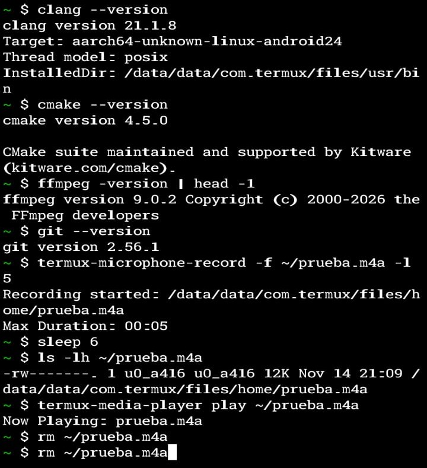

# Guía: preparar Termux (Etapa 1)

Pasos para dejar el teléfono listo antes de añadir modelos.

## 1. Instalación
Termux y Termux:API instalados desde la misma fuente oficial (F-Droid o GitHub Releases).
Permiso de micrófono concedido a Termux:API.
## 2. Actualizar paquetes:
En termux: pkg update && pkg upgrade -y

## 3. Instalar las herramientas:
EN TERMUX: pkg install -y git cmake clang make ffmpeg termux-api

## 4. Verificar el compilador y las herramientas

uname -m
clang --version
cmake --version
ffmpeg -version | head -1
git --version

## 5. Probar el micrófono

termux-microphone-record -f ~/prueba.m4a -l 5
sleep 6
ls -lh ~/prueba.m4a
termux-media-player play ~/prueba.m4a
rm ~/prueba.m4a

resultados: 