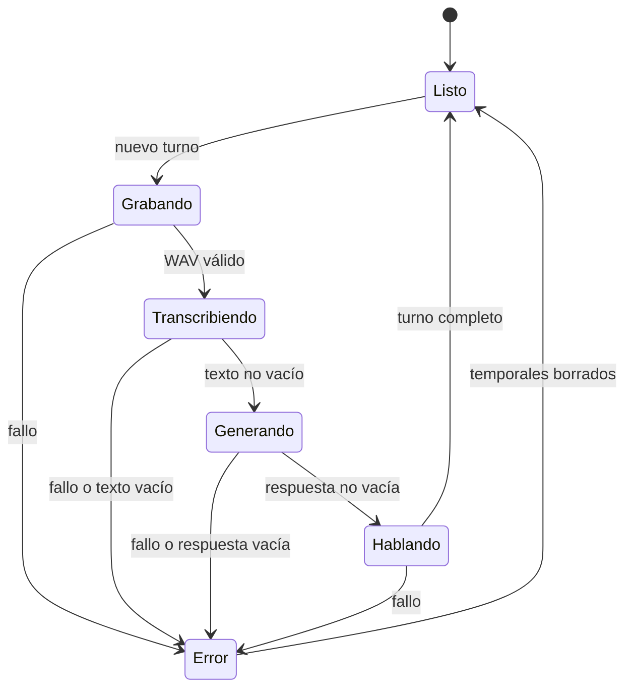

# Orquestador en C++ (Etapa 6)

Programa `jarvis-son`: conecta las cuatro etapas (captura, STT, SLM y TTS) en un turno de voz a voz, con estados claros, errores visibles y limpieza de temporales. Contrato de cada etapa en `docs/interfaces.md`.

## Máquina de estados



Los estados son secuenciales: cada proceso termina antes de que empiece el siguiente, de modo que STT y SLM nunca conviven en memoria.

## Compilar

Termux (teléfono) o Linux (por ejemplo, CI):

```bash
cmake -B build
cmake --build build -j2
ctest --test-dir build --output-on-failure
```

Solo se usa C++17 y funciones POSIX (`fork`, `execvp`, `wait4`, `poll`), sin dependencias externas. Las pruebas no necesitan micrófono ni modelos: usan programas simulados (`tests/stubs/`).

## Usar

Desde la raíz del repositorio (las rutas por defecto de los scripts son relativas):

```bash
./build/jarvis-son --check                 # comprueba rutas y parámetros
./build/jarvis-son --show-text             # un turno de voz a voz
./build/jarvis-son --turns 10 --log docs/orquestador-turnos.csv
```

| Opción | Efecto |
|---|---|
| `--turns N` | turnos consecutivos (1 a 100) |
| `--seconds N` | segundos de grabación por turno (1 a 30; 5 por defecto) |
| `--threads N` | hilos de STT y SLM (1 a 16; 4 por defecto) |
| `--log ARCHIVO` | agrega tiempo y memoria pico por etapa a un CSV (sin texto de la conversación) |
| `--show-text` | muestra la transcripción y la respuesta en pantalla (no se guardan) |
| `--check` | valida la configuración y termina |

Rutas por variables de entorno (valores por defecto del equipo de pruebas): `JARVIS_CAPTURE`, `JARVIS_TTS`, `JARVIS_WHISPER_BIN`, `JARVIS_WHISPER_MODEL`, `JARVIS_LLAMA_BIN`, `JARVIS_LLAMA_MODEL` y `JARVIS_TMPDIR`.

Códigos de salida: `0` todos los turnos correctos, `1` algún turno falló, `2` configuración o argumentos inválidos, `130` interrumpido con Ctrl+C.

## Qué hace en cada turno

| Estado | Proceso | Notas |
|---|---|---|
| Grabando | `scripts/capture.sh <s> <wav>` | comprueba que el WAV exista y no esté vacío |
| Transcribiendo | `whisper-cli -m <base> -f <wav> -l es -t 4 -nt -np` | borra el WAV al terminar; limpia el texto; si queda vacío, el turno falla sin llamar al SLM |
| Generando | `llama-completion ... -c 1024 -n 96 -no-cnv -p <prompt>` | quita `[end of text]` y tokens especiales de la respuesta |
| Hablando | `scripts/tts.sh` | el texto entra por entrada estándar |

## Seguridad y limpieza

- **Sin shell:** los procesos se lanzan con `execvp` y una lista fija de argumentos. El texto transcrito viaja como un único argumento del SLM (o por entrada estándar al TTS); nunca se concatena en una línea de comandos. Hay una prueba con texto como `; touch ... && echo \`id\` | cat` que verifica que no se interpreta.
- **Rutas validadas** antes de empezar (existen y tienen permiso); las rutas configuradas deben contener `/`, así que nunca se buscan en `PATH`.
- **Límites:** transcripción de hasta 300 bytes, respuesta de hasta 400 bytes, salida de cada proceso limitada a 64 KB y tiempo máximo por etapa.
- **Temporales:** cada turno usa un directorio privado (`mkdtemp`) que se borra siempre, con éxito o con error; el WAV se borra apenas termina el STT.
- **Procesos huérfanos:** cada etapa corre en su propio grupo de procesos; si se agota el tiempo, el usuario interrumpe o la etapa termina dejando descendientes, se eliminan.
- **Fallos distinguidos:** código de salida ≠ 0, tiempo agotado, interrupción y muerte por señal (la señal 9 se informa como posible falta de memoria).
- **Privacidad:** el CSV de `--log` solo contiene tiempos y memoria; la conversación no se escribe a disco.

## Memoria y tiempos por etapa

El orquestador registra, por etapa, el tiempo y la memoria residente máxima del proceso hijo (`wait4`), equivalente a `time -f "%e %M"`. Para el TTS del sistema, la memoria medida es la de `scripts/tts.sh`; el motor de voz corre en otro proceso de Android y no se mide.

## Pruebas automáticas

| Prueba | Qué comprueba |
|---|---|
| `texto` | limpieza de transcripción y respuesta (casos reales observados), marcadores de Whisper, tokens especiales, UTF-8, prompt |
| `procesos` | salida, stdin, argumentos con metacaracteres, código de salida, señal 9, programa inexistente, tiempo agotado y descendientes, tope de salida, entrada grande sin interbloqueo, interrupción |
| `turno_con_stubs` | turno completo con programas simulados: éxito, transcripción vacía, fallo del STT, muerte del SLM, texto malicioso, limpieza de temporales, CSV sin texto, configuración inválida |

## Limitaciones

- La grabación dura un tiempo fijo; no detecta el fin del habla.
- Un solo turno a la vez; no hay interrupción de la voz mientras habla (fuera del alcance de la V1).
- La calidad de la respuesta depende del STT y del SLM: un error de transcripción se propaga al resto del turno.
- Está escrito para Linux y Android (la memoria máxima se lee en KB, como en esos sistemas).
